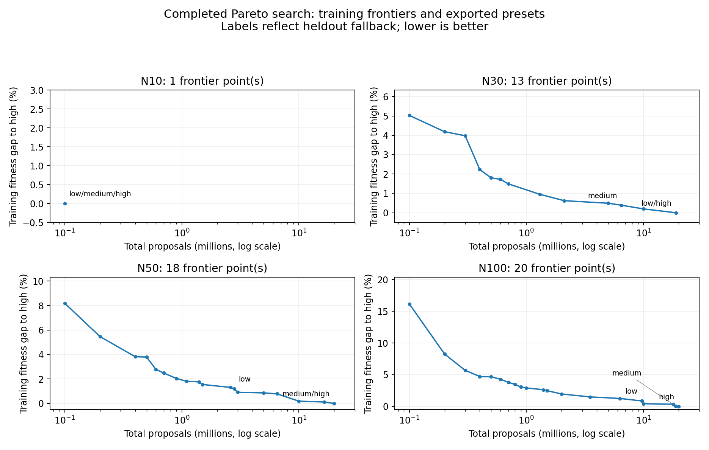

# Completed Pareto tuning: results and web app readiness

**Recommendation: start building the web app prototype now.** The optimizer has
useful measured cost/quality tradeoffs and promising local latency. Further
blanket tuning is less valuable than testing the frozen presets on fresh inputs
and building the scheduling workflow. The current data supports a prototype
within the tested problem family; it does not establish production readiness or
guaranteed quality percentages for arbitrary schedules.

This report analyzes `results/pareto-tuning` and the exported
`flexo/profiles.json`. The accompanying [numeric snapshot](pareto-tuning-summary.json)
preserves parameters, metrics, fingerprints, uncertainty estimates and timing
samples. Source measurements remain in the campaign directory.

## Campaign integrity and scope

All four sizes completed **400 successful configurations**, with no running or
failed SMAC evaluations in the saved histories. Every candidate has all **20
training snapshots x three seeds**: 96,000 candidate solves altogether. The
SQLite cache contains **97,080 unique completed solves**, including normalization
and heldout verification. Final progress counters report 97,021 computed and 59
cached solves for that invocation; these counters are not lifetime totals across
resumes.

Checks performed for this report:

- Recomputed every frontier and training preset mapping from the 1,600 candidate files.
- Checked history scores/costs against candidate records and complete seed panels.
- Checked exported profiles match per-size results and all exported preset gates pass.
- Verified the current dataset and native binary fingerprints match the campaign.
- Independently rescored 16 newly timed schedules and checked exact proposal budgets.

The campaign used 20 solve workers, training seeds 42/43/44 and heldout seeds
142/143/144. Training panels averaged about **16.3 CPU-seconds per wall-second**,
showing substantial parallel work. The first-to-last SMAC evaluation timestamp
span was **84.3 minutes**; this excludes initial normalization before the first
trial and final verification after the last, and is not total campaign runtime.

## Exported presets

Lower fitness is better. Gaps below compare the **mean normalized heldout
fitness** with that size's high preset. A zero gap can mean two presets use the
same configuration. Proposal counts are totals across starts.

| Movable jobs | Preset | Total proposals | Starts | Heldout gap to high | Proposal saving vs high |
| ---: | --- | ---: | ---: | ---: | ---: |
| 10 | low / medium / high | 100,000 | 1 | 0.000% | 0% |
| 30 | low / high | 19,000,000 | 6 | 0.000% | 0% |
| 30 | medium | 6,500,000 | 7 | +0.366% | 65.8% |
| 50 | low | 2,800,000 | 2 | +1.048% | 86.0% |
| 50 | medium / high | 20,000,000 | 4 | 0.000% | 0% |
| 100 | low | 9,700,000 | 3 | +0.503% | 51.5% |
| 100 | medium | 18,800,000 | 4 | -0.014% | 6.0% |
| 100 | high | 20,000,000 | 4 | 0.000% | 0% |

**N10 is the clearest win.** Its sole frontier point uses 100k proposals and one
start, matching all measured training and heldout baseline means. That is 94.1%
fewer proposals than the previous 1.7m export. This does not prove optimality or
that every possible ten-job instance is equally easy.

**N30 medium and N50 low are useful practical tradeoffs.** N100 medium is almost
the same cost as high, while low provides the meaningful speed/quality choice.
Its slightly better heldout medium mean does not establish superiority over high;
high was selected on training data.

At N50 and N100, high is the prior SA parameter set at 20m proposals, introduced
in the initial design. SMAC found better efficiency points but did not beat that
anchor's training quality. The run does not show that those parameters are
globally optimal, or that 20m is necessary for good schedules.

### Fallbacks reveal a preset policy issue

- **N30 low:** the proposed 500k setting regressed 2.031% overall and 2.337% on
  carryover, exceeding its 2% gate. It correctly fell back to high. Consequently,
  exported **low costs 19m while medium costs 6.5m**. This violates the expected
  ordering of a low/medium/high product control.
- **N50 medium:** the proposed 10m setting regressed only 0.311% overall, but
  0.557% on carryover, exceeding its 0.5% gate. It fell back to high, so these two
  labels currently produce identical schedules for the same seed.

Keep the conservative exported results for analysis. Before exposing presets in
the UI, make their cost ordering consistent: a failed low tier can share the
already-approved medium configuration, rather than becoming more expensive.
Do not search for new replacement candidates using heldout scores. Confirm the
final policy on a fresh test set. Show only distinct options when tiers coincide.

## How reliable are the quality differences?

Preset gates apply to overall and clean/carryover **means**, not every instance.
For example:

| Preset | Overall gap | Clean mean gap | Carryover mean gap | Worst instance mean gap |
| --- | ---: | ---: | ---: | ---: |
| N30 medium | +0.366% | +0.317% | +0.414% | +3.229% |
| N50 low | +1.048% | +0.396% | +1.729% | +4.322% |
| N100 low | +0.503% | -0.169% | +1.239% | +2.233% |
| N100 medium | -0.014% | -0.197% | +0.187% | +0.906% |

Each instance mean uses three seeds. The worst individual seeded solve may differ
more; this table is not a per-request guarantee. Carryover remains the more
sensitive group for these cheaper presets.

A descriptive paired-replica bootstrap gives approximately these 95% intervals
for the overall normalized gap: N30 medium **[0.121%, 0.723%]**, N50 low
**[0.661%, 1.495%]**, N100 low **[0.326%, 0.677%]**, N100 medium
**[-0.146%, 0.117%]**. The N30 medium interval extends above its nominal 0.5%
tolerance. These gates are empirical point estimates, not confidence guarantees.

Method: 5,000 resamples, fixed RNG seed 20261101, resampling the ten generation
replicas with their clean/carryover pair kept together. Three-seed means remain
fixed; intervals do not account for configuration selection or all seed noise.

## Was 400 enough?

Enough to provide useful prototype presets, but not to certify search convergence.
High quality stopped improving early for N30/N50/N100; the efficiency frontier
continued changing, especially at N100.

| Jobs | Frontier points | First trial with exported high configuration | Final frontier points discovered in trials 301-400 | Frontier area gain, 300 to 400 |
| ---: | ---: | ---: | ---: | ---: |
| 10 | 1 | 373 | 1 | 0.000% |
| 30 | 13 | 119 | 5 | 0.136% |
| 50 | 18 | 66 | 4 | 0.076% |
| 100 | 20 | 66 | 10 | 1.028% |

N10 already had the same best quality and proposal cost by trial 100; its late
exported configuration improves the starts tie-break, not either Pareto objective.
Area is two-objective dominated hypervolume with a fixed reference of normalized
fitness 1.05 and 20.1m proposals; it measures coverage of this cost/quality region,
not a percentage improvement in schedule quality.

Do not automatically rerun all sizes at 1,000 trials. If later latency tests show
N100 needs a cheaper middle preset, target that efficiency region. Additional
search needs fresh final validation; simply increasing `--trials` in the completed
work directory is refused by the current manifest compatibility check.

## Speed and historical comparison

Saved tuning timings include contention from 20 concurrent single-thread solves.
They should not be presented as interactive user latency. For a small sanity
check, I ran requests sequentially with `num_threads=0`, allowing each solve to
parallelize its starts, on heldout clean/carryover replica 00 with seed 142:

| Jobs | Preset | Observed isolated request time |
| ---: | --- | ---: |
| 10 | all | 0.009-0.010 s |
| 30 | medium | 0.188-0.244 s |
| 30 | low / high | 0.715-0.903 s |
| 50 | low | 0.332-0.417 s |
| 50 | medium / high | 1.257-1.635 s |
| 100 | low | 1.165-1.317 s |
| 100 | medium | 1.859-2.176 s |
| 100 | high | 1.954-2.381 s |

These are two inputs per configuration on this Windows machine, including input
preparation, not a latency distribution, rolling-horizon timing, server load test
or browser/WASM benchmark. All 16 schedules passed independent rescoring.

For context, heldout raw mean fitness of high changed from the previous campaign:
N10 **3.45328 -> 3.45328**, N30 **7.32456 -> 7.30625**, N50
**12.00200 -> 11.96622**, N100 **24.54357 -> 24.44813**. Improvements for the
larger sizes are about 0.25-0.39%, partly purchased with more proposals. The two
campaigns share the same dataset and seed panels but have different binary
fingerprints, so this is historical context, not a controlled algorithm comparison.

## Web app readiness and next steps

The data is adequate to start the scheduling UI and optimizer integration. It is
too narrow to claim broad production quality:

- All snapshots use the same three machine rates (112/224/175) and sample from
  15 original job templates, with quantity multipliers from 0.85 to 1.15.
- Sizes are 10/30/50/100 movable jobs. Intermediate sizes use nearest-profile
  selection and have not been certified by this campaign.
- Every snapshot uses default ink transition costs, setup time and objective
  weights. Custom matrices, other machine counts, unusual loads and substantially
  different objective weights have no tuning evidence here.
- Carryover is one previous horizon. The campaign does not test whole rolling
  sequences or establish long-run scheduling quality.
- The heldout collection was also used by the previous campaign, and old selected
  profiles supplied warm starts. It was excluded from this campaign's SMAC
  objective, but is not a fresh, untouched final test for the project as a whole.

Recommended order:

1. **Freeze this result and build the prototype.** Archive the campaign and
   version the exported profiles with their dataset/binary identifiers. The
   current `flexo/profiles.json` is untracked and `results/` is Git-ignored; a fresh
   clone otherwise falls back to untuned defaults. Keep three seeds for now.
2. **Fix the preset ordering before adding the quality selector.** Share duplicate
   choices and show their actual budget. Do not promise a per-schedule percentage
   loss from these mean-based gates.
3. **Run frozen presets on a fresh acceptance collection.** Prioritize new
   instance diversity over increasing seeds alone: intermediate job counts,
   near-capacity jobs, skewed machines, ink patterns/custom matrices, varied
   objective weights, and different amounts of locked work. Include realistic
   user schedules when available. Treat any later tuning as consuming that set
   and reserve another fresh set for final acceptance.
4. **Verify rolling behavior and actual latency.** Start with the existing five
   representative validation cases, then the 200-instance collection if the
   quick pass is sound. Compare fitness, ink cost, flow time, preserved locked
   work and runtime against the prior frozen settings on the same build/seeds.
   Measure request latency and concurrency on the intended deployment hardware.
5. **Build a thin end-to-end slice:** input jobs and transitions, optimize the
   current horizon, display the existing timeline/metrics, lock started jobs,
   change inputs and reschedule. Keep the request's inputs, seed, profile version
   and result for reproducibility. Bound concurrent optimizer workers globally
   for multiple users; giving every simultaneous request all CPUs oversubscribes
   the machine.

A Python-backed prototype can reuse the measured native engine. A browser/WASM
deployment needs its own build, threading and timing checks; this campaign does
not validate that route. No additional tuning or app implementation was launched
as part of this report. The remaining priority is validation and product behavior,
not finding a universally optimal SA configuration before building anything.
