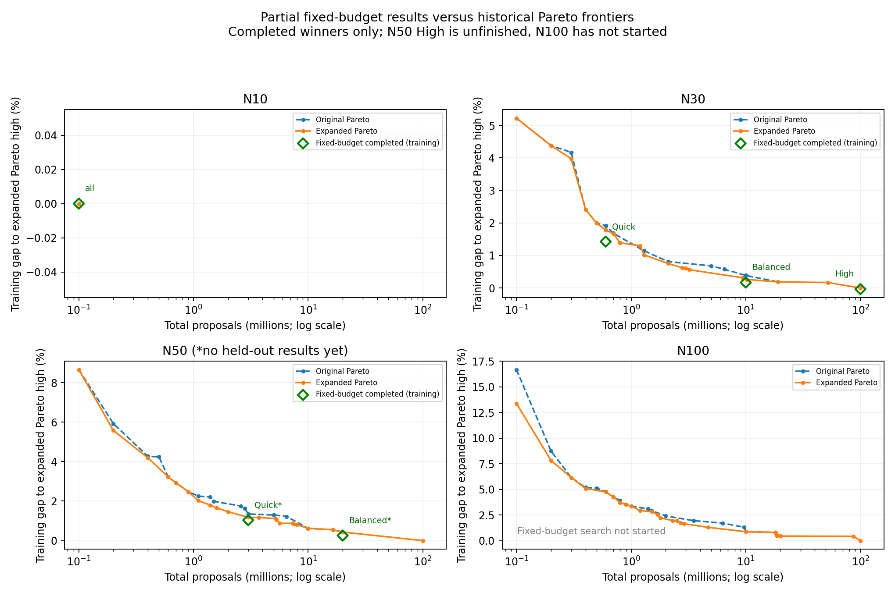

# Fixed-budget tuning: partial results (2026-11-02)

**Focused tuning found modest improvements on training data, but has not yet
shown a compelling across-the-board held-out benefit.** N30 Balanced is a useful
10m compute tier. N30 Quick's improved training result did not generalize; N30
High's held-out gain is negligible relative to its tuning expense. N50 Quick and
Balanced have better training scores but still need held-out evaluation.

The run is paused. This analysis reads saved files only; no tuning or additional
optimizer evaluations were launched. Existing application presets are unchanged.
The [partial numeric snapshot](fixed-budget-partial-summary.json) records winners,
parameters, completed histories, progress checkpoints, timing and held-out results.
The expanded Pareto analysis below remains the historical comparison baseline.

## Completion and integrity

Completed searches: N10/100k; N30/600k, 10m and 100m; N50/3m and 20m. Each completed
search added 400 trials beyond its exact-budget imported observations. N10's three
preset labels share one search. Across these six searches, 2,400 additional trials
are complete. Saved successful observation counts, including imports, are
930, 434, 402, 402, 421 and 404 respectively (N30 ordered low/medium/high; N50
low/medium).

N50/100m has 25 finished observations and one interrupted observation, including
imports, with no winner checkpoint. N100 has not started. Neither unfinished
search contributes a new selected point to this analysis or chart.

Checks: dataset/native binary fingerprints match the fixed campaign; every
completed candidate has the correct locked budget, 20 instances and training
seeds 42/43/44. Training scores were independently recomputed, SMAC history costs
matched to candidates, and winners checked against all saved candidates. N10/N30
held-out aggregate scores were recomputed from saved measurements. These are data
integrity checks, not new optimizer runs or independent acceptance tests.

## Does quality improve at the same compute cost?

Positive improvement means lower mean normalized training fitness. The exact-cost
comparison uses the best prior expanded-Pareto candidate with exactly that budget;
the cap comparison uses the best previous candidate costing no more than it.

| Jobs / preset | Budget | Winner starts | Training improvement vs prior exact cost | Improvement vs prior budget cap | Recorded new-panel hours |
| --- | ---: | ---: | ---: | ---: | ---: |
| N10 / all | 100k | 1 | 0.000% | 0.000% | 0.10 |
| N30 / Quick | 600k | 8 | 0.350% | 0.350% | 0.12 |
| N30 / Balanced | 10m | 13 | 0.219% | 0.148% | 1.12 |
| N30 / High | 100m | 9 | 0.035% | 0.035% | 11.31 |
| N50 / Quick | 3m | 1 | 0.143% | 0.143% | 0.55 |
| N50 / Balanced | 20m | 4 | 0.174% | 0.174% | 3.26 |

Hours sum saved new candidate panel wall times; they exclude model fitting,
normalization, held-out work and interrupted work without a candidate record.
They are neither an isolated-request latency benchmark nor a total campaign
stopwatch. In particular, N30 High repeats a 100m solve across 20 instances and
three seeds for each configuration, explaining its large tuning cost.

The green markers are completed fixed-budget winners, including N50's
training-only results. No marker or connecting inference is supplied for unfinished
N50 High or N100. All gaps use the expanded-Pareto high as a common training
reference; a negative value means beating that historical reference. The plotted
frontier lines are visual guides between measured candidates, not measurements at
every intermediate budget.

## Held-out results: N10 and N30 only

| Selected setting | Held-out fitness change vs previous exported counterpart | Gap to new N30 High |
| --- | ---: | ---: |
| N10 / all | -0.0085% | not applicable |
| N30 / Quick, 600k | +0.421% (worse) | +2.287% |
| N30 / Balanced, 10m | +0.392% (worse, but 90% cheaper than the old exported 100m medium) | +0.407% |
| N30 / High, 100m | -0.0155% | 0.000% |

N30 Balanced's exported-counterpart comparison is **not equal-cost**: the previous
exported medium fell back to 100m. Against the old proposed 9.4m medium candidate,
the new 10m candidate improves held-out fitness by 0.101%, spending 6.4% more
proposals. It is a useful distinct middle tier, not evidence of a large algorithmic
breakthrough.

N30 Quick is the important counterexample to declaring training improvements a
success. Its held-out gap to the new High is 2.287% overall, 2.463% clean and
2.111% carryover. It would fail the former 2% quality gate; fixed compute tiers
correctly retain it and report the tradeoff instead of silently changing its cost.
The old 600k Quick remains a credible comparison for fresh acceptance testing.
Do not automatically replace it with the new training winner.

N30 Balanced is 0.407% behind new High overall, with clean/carryover gaps of
0.515%/0.300%. It would narrowly fail the former per-group 0.5% gate. The compute-tier
policy is what allows this useful option to remain distinct.

Descriptive 95% paired-replica bootstrap intervals for change against the previous
export: N30 Quick [-0.132%, +1.112%]; N30 High [-0.052%, +0.023%]. Both include zero,
so the small observed High gain is not convincing evidence of a general advantage.
N10's tiny improvement is tie-level behavior, not a meaningful tuning win. Its
new held-out normalized fitness (1.000394) is still worse than the original 20m
campaign's 100k selection (1.000000).

Bootstrap: 5,000 resamples, seed 20261102, keeping each generation replica's
clean/carryover pair together and its three-seed means fixed. As before, these
intervals omit selection uncertainty and use a repeatedly inspected held-out set.
They are descriptive, not fresh acceptance evidence.

**No held-out claim is available for N50 Quick/Balanced.** The current runner
writes a size's validation only after all its budget searches finish. The absence
of an N50 profile is expected while High is incomplete, and does not mean the
completed winner checkpoints were lost.

## Was the time worth it, and what next?

- **N10:** no meaningful gain. Stop allocating additional tuning here for this
  instance family; preserve the 100k budget.
- **N30 Quick:** training improved, held-out did not. This is consistent with
  selection/seed noise or overfitting; the current data cannot identify the cause.
- **N30 Balanced:** the clearest practical outcome so far: a 10m middle option
  with a measured 0.407% overall gap to new High. Extra search produced modest
  improvements rather than a dramatic efficiency gain.
- **N30 High:** 11.31 recorded panel hours for a 0.0155% held-out gain is poor
  marginal value. The older high remains essentially competitive.
- **N50 Quick/Balanced:** potentially useful, but provisional until evaluated on
  held-out/fresh data. Quick found most of its improvement late; its best training
  score improved about 0.139% during the final 100 trials. Balanced improved about
  0.016% in that final block. Late improvements exist, without guaranteeing they
  generalize.

Do not add another blanket 400 trials. Review the completed winners against old
settings on fresh instances, especially N30 Quick and both N50 tiers. For an
immediate partial evaluation, held-out assessment can be separated from the
unfinished High search in a future runner update; this report does not modify
or execute the tuning pipeline. Completing remaining searches is a choice about
tuning compute, not a prerequisite for retaining the already completed results.

One browser integration issue is now concrete: N30 Balanced uses **13 starts**,
while current browser input/worker validation caps starts at ten. Test and update
browser support before adopting this winner; the native tuner accepts it. The
app's existing presets remain untouched by this analysis.

---

## Historical expanded Pareto analysis

**The additional 400 trials per size were useful. Another blanket increase to
1,000-1,200 additional trials is not the next priority.** High improved mean
normalized held-out fitness by only 0.140-0.440% for N30/N50/N100, at roughly five
times the old high proposal cost. Cheaper configurations improved too, especially
at N100. Medium now shares high at all three sizes under the current quality gates.

This report supersedes the [original 20m report](pareto-tuning-report-20m.md).
It compares `results/pareto-tuning-100m-20starts` with `results/pareto-tuning`.
The [numeric snapshot](pareto-tuning-summary.json) contains selected parameters,
preset metrics, bootstrap intervals, fixed-budget curves, and convergence data.
The [old numeric snapshot](pareto-tuning-summary-20m.json) is retained separately.
Fitness improvements are not equivalent to reductions in makespan or ink use
individually, and proposal savings are not measured browser speedups.

## Integrity and scope

All four sizes finished **800 successful observations each**: 400 imported and
400 additional configurations. Histories have no running or failed evaluations.
All 1,600 imported candidate records are unchanged. The 3,200 candidate panels
each contain 20 training snapshots and three seeds: **192,000 candidate solves
represented**, including 96,000 from the original campaign.

The SQLite cache grew from 97,080 to **193,560 unique completed solves**: a net
addition of 96,480, including baseline/held-out work. Final progress reports
95,979 computed and 501 cached solves for the final invocation; these are not
lifetime counters and exclude work saved before the interrupted session resumed.

Checks performed without further optimization:

- Matched dataset and current native binary fingerprints to the manifest.
- Confirmed the exported `flexo/profiles.json` equals the four per-size profiles.
- Checked all candidate instance/seed panels, recomputed training summaries,
  and matched all 3,200 SMAC objective pairs to candidate records.
- Recomputed frontiers and training preset selections; all exported held-out
  presets pass their applicable overall and case-type quality gates.
- Confirmed old and new normalization means agree.

Bounds were **1-20 starts** and **100k-100m total proposals in 100k steps**.
The total budget is shared across starts, not multiplied by starts. The same
three-machine datasets and objective were used, with balanced clean/carryover
snapshots, training seeds 42/43/44, and held-out seeds 142/143/144.

## Exported presets

Lower fitness is better. Held-out gaps compare mean normalized fitness with the
expanded high for that size. Gates apply separately to overall, clean, and
carryover means: 2% for low and 0.5% for medium.

| Jobs | Preset | Total proposals | Starts | Held-out gap to high | Proposal saving vs high |
| ---: | --- | ---: | ---: | ---: | ---: |
| 10 | low / medium / high | 100,000 | 1 | 0.000% | 0% |
| 30 | low | 600,000 | 3 | +1.843% | 99.4% |
| 30 | medium / high | 100,000,000 | 4 | 0.000% | 0% |
| 50 | low | 3,000,000 | 3 | +1.231% | 97.0% |
| 50 | medium / high | 100,000,000 | 4 | 0.000% | 0% |
| 100 | low | 10,000,000 | 4 | +0.804% | 90.0% |
| 100 | medium / high | 100,000,000 | 4 | 0.000% | 0% |

Low supplies the useful interactive tradeoffs. N30 now has a valid inexpensive
low preset, avoiding the original fallback that made low costlier than medium.
These are mean-based empirical results, not per-schedule guarantees.

### Why medium became high

**N30:** training selected a 9.4m, six-start medium candidate. Its held-out overall
gap was 0.493%, but carryover was **0.510%**, narrowly exceeding the 0.5% gate;
clean was 0.476%. The policy correctly fell back to high. This is a borderline
generalization failure, not a logging or calculation error.

**N50/N100:** medium already equaled high during training selection. Their old
20m high points are only 0.432%/0.445% behind the expanded high overall on
training, but carryover gaps are **0.705%/0.800%**. They fail the separate
carryover gate. No cheaper frontier point meets all medium training gates.

Raising the quality reference makes the same tolerance harder to satisfy.
The collapse is consistent with the policy, but gives little product
differentiation. Do not silently loosen gates or search for replacements on
this held-out set.

## What did the extra compute buy?

| Jobs | Old high proposals | Expanded high proposals | Training improvement | Held-out improvement |
| ---: | ---: | ---: | ---: | ---: |
| 10 | 100,000 | 100,000 | 0.000% | -0.048% |
| 30 | 19,000,000 | 100,000,000 | 0.186% | 0.140% |
| 50 | 20,000,000 | 100,000,000 | 0.430% | 0.337% |
| 100 | 20,000,000 | 100,000,000 | 0.443% | 0.440% |

For N30/N50/N100, high uses the **prior SA parameter family, four starts, and the
maximum 100m budget**, included as an initial anchor. New parameter combinations
did not beat that anchor on training. Final best quality was already available
within the first 100 additional observations at each size. This suggests
diminishing returns; it does not prove those parameters globally optimal.

N10's best training quality and budget stayed unchanged. A different parameter
combination won the training tie-break and regressed held-out quality by 0.048%.
The new tied combination is not demonstrated to be better. More tuning offered
no measured training benefit for this size.

Descriptive paired-replica bootstrap intervals for held-out fitness change
`expanded high / old high - 1`:

| Jobs | Change | Approximate 95% interval |
| ---: | ---: | ---: |
| 10 | +0.048% | [0.000%, +0.113%] |
| 30 | -0.140% | [-0.228%, -0.065%] |
| 50 | -0.337% | [-0.448%, -0.232%] |
| 100 | -0.440% | [-0.636%, -0.267%] |

Larger-size gains appear consistent within this sampled family, but small in
practical magnitude. These intervals do not establish independent post-selection
significance: the held-out collection has been reused across campaigns.

### Fixed-budget efficiency

Best observed training improvement over the old campaign at the same proposal
cap; positive means lower fitness. This isolates efficiency from spending more.

| Jobs | At 100k | At 1m | At 3m | At 5m | At 20m |
| ---: | ---: | ---: | ---: | ---: | ---: |
| 10 | 0.000% | 0.000% | 0.000% | 0.000% | 0.000% |
| 30 | 0.000% | 0.289% | 0.201% | 0.116% | 0.000% |
| 50 | 0.000% | 0.000% | 0.163% | 0.124% | 0.000% |
| 100 | 2.829% | 0.000% | 0.749% | 0.642% | 0.000% |

N100 has the clearest efficiency gains at small/intermediate budgets. No size
improved the best training quality available at 20m. The high-quality gain comes
from extending the budget. These fixed-budget candidates have not all been
checked on held-out data; they are not certified replacement presets.

### Did allowing 20 starts help?

The new search evaluated **390 configurations above ten starts** across all sizes.
Only one survives on the final frontiers: N30 at 300k total proposals with 12
starts. Every exported preset uses at most four starts. Retaining the option is
reasonable, but the data does not support defaulting browser requests to 20 starts.

## Is more tuning worthwhile?

| Jobs | Original to expanded frontier points | Frontier area gain in last 100 additional observations |
| ---: | ---: | ---: |
| 10 | 1 to 1 | 0.000% |
| 30 | 13 to 19 | 0.031% |
| 50 | 18 to 22 | 0.014% |
| 100 | 20 to 25 | 0.020% |

Area is dominated hypervolume with a fixed reference of normalized fitness 1.05
and 100.1m proposals at every checkpoint. It measures frontier coverage, not
schedule-quality improvement. Additional observations follow saved SMAC history
order, excluding the 400 imports. Even the original frontier uses this expanded
reference for comparison.

Late refinements continued, but gains are small and high was flat after the
first 100 additional observations. **Stop blanket tuning here.** Next steps:

1. Freeze these results and make coincident presets clear in the UI. Under this
   policy, medium/high are identical at N30/N50/N100.
2. If a useful middle tier is required, test a fixed-parameter budget ladder
   around 10m/20m/30m/50m/75m/100m, prioritizing N50/N100 carryover. The sparse
   global search has not located the 0.5% boundary between 20m and 100m. Select
   using training data and accept using a fresh final test collection.
3. Decide whether product presets represent strict mean-quality tolerances or
   explicit latency/compute budgets. For the latter, define budgets first and
   select within them. Neither policy should promise per-schedule percentages.
4. Validate frozen settings on new instance diversity: intermediate sizes,
   machine rates/counts, objective weights, custom matrices, locked-work levels,
   and rolling sequences. More search on this family cannot replace coverage.

## Browser rollout and limitations

`packages/optimizer/flexo/profiles.json` contains the expanded export.
**The checked-in browser `apps/web/lib/profiles.json` still contains the previous
presets.** The WASM build script regenerates browser profiles from the native
export and enforces monotone low/medium proposal cost. The next full WASM build
can therefore introduce 100m medium/high settings. Review this before deployment.

Do not adopt 100m as the browser default from native tuning alone. Benchmark the
exact WASM build on desktop/mobile hardware, including cancellation,
responsiveness, and runtime/battery tradeoffs. Native timings under 20-worker
contention are not interactive latency measurements. New training panels averaged
15.1/18.5/19.0/19.1 CPU-seconds per wall-second for N10/N30/N50/N100, showing strong
pool use. Summed new-panel wall time was 242 minutes, excluding model fitting and
held-out work; this is not a total campaign stopwatch.

Scope remains the original three machine rates (112/224/175), jobs sampled from
15 industry templates with quantity jitter, default transitions/setup/weights,
and one preceding horizon for carryover. Held-out cases were excluded from the
SMAC objective but are no longer a fresh project-level acceptance collection.
Gates protect sampled means, not each schedule. The worst held-out instance-mean
low/high gaps were **4.621% at N30, 4.941% at N50, and 2.878% at N100**. Low's
overall gap intervals were [1.447%, 2.273%], [0.744%, 1.800%], and [0.526%, 1.098%].

Bootstrap method: 5,000 resamples, RNG seed 20261101, sampling ten generation
replicas with clean/carryover pairs kept together; three-seed means remain fixed.
Intervals omit selection uncertainty and do not fully model seed noise. Ratios
use tuning's per-instance normalization. No new tuning, app preset changes, or
runtime benchmarks were performed for this report.
